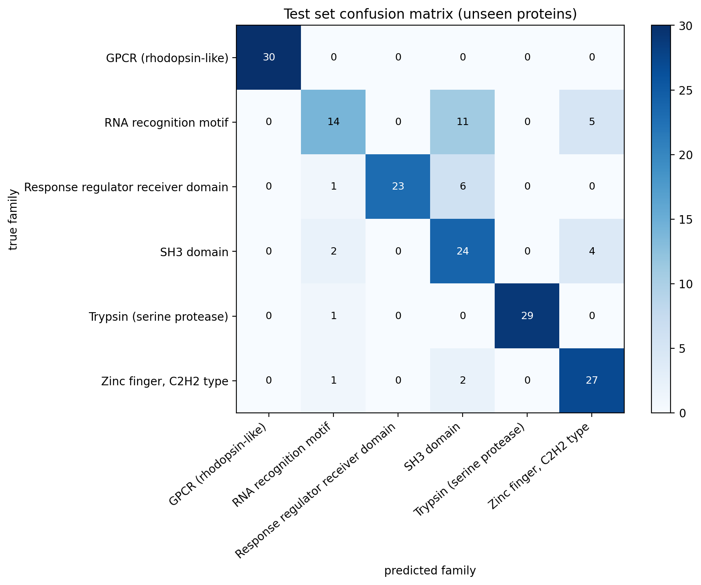

# Unsupervised Protein Family Classification

A bioinformatics pipeline utilizing unsupervised **Hierarchical Agglomerative Clustering** to classify protein sequences into structural families based on structural feature engineering. 

The distance-geometry mapping engine achieves an **81.7% accuracy score on unseen test data** via nearest-centroid assignment.

## 📊 Pipeline Architecture
1. **Feature Engineering:** Sequences are extracted from UniProt and converted into numerical density spaces combining **Amino Acid Composition (AAC)** and **Dipeptide Composition (DPC)** (420 input dimensions).
2. **Variance Compression:** Principal Component Analysis (PCA) maps feature spaces into **200 orthogonal components**, retaining **89.7%** total cumulative variance.
3. **Hierarchical Topology:** Clustering is built on training datasets via **Ward's minimum variance linkage criterion** and Euclidean metrics.
4. **Generalization Profile:** Unseen proteins are assigned to the topological cluster maps using minimum distance evaluations against learned cluster centroids.

## 📈 Model Performance
* **Adjusted Rand Index (ARI):** 0.603
* **Normalized Mutual Information (NMI):** 0.703
* **Overall Test Accuracy (Purity):** 81.7%

### Test Set Evaluation Heatmap
The model achieves near-flawless isolation of structurally isolated families like *GPCR* and *Trypsin*, with localized classification boundary overlapping between the structurally overlapping *SH3 domain* and *RNA recognition motif* families.

## 🛠️ Local Web Deployment
A functional web application frontend interface is built inside the ecosystem utilizing `Streamlit`.
